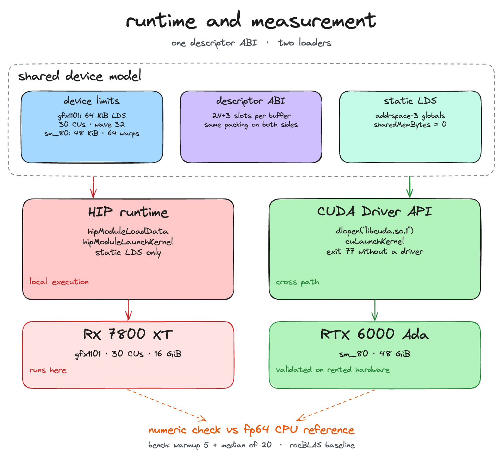

# kernel.h

kernel.h compiles a C++23 kernel description into AMD and NVIDIA GPU machine
code, loads it, and compares the result against an fp64 CPU reference. One
description produces gfx1101 HSACO and sm_80 cubin through a structured-SSA IR
and MLIR.

Use it for compiler and GPU performance experiments on AMD and NVIDIA targets.
A schedule change is a builder-chain edit: tile size, warp mapping,
shared-memory staging, vector width, and unroll factor are attributes, and the
kernel template stays fixed.
Seven templates cover vecadd, GEMM, softmax, layernorm, scan, fused_gelu, and
attention.

Production numerical work should use rocBLAS or cuBLAS. The kernels use scalar
fp32 FMAs, and tensor cores are out of scope.

The host prerequisites are Linux, Nix with flakes enabled, and devenv 2.x.
Enter the development shell and build:

```sh
devenv shell
# inside the shell
build
ctest --test-dir build --output-on-failure
```

The shell pins LLVM/MLIR 21.1.8, ROCm 7.2.3, CUDA 12.9, CMake, and Ninja from
the Nix binary cache. Local execution also needs ROCm 7.2.3 and a gfx1101 GPU
(RX 7800 XT here). The NVIDIA path cross-compiles on the same machine; running
its cubin needs an sm_80 GPU and an NVIDIA driver.

`ctest` runs the unit, lit, and on-GPU end-to-end suites. The end-to-end cases
compare each kernel against the fp64 reference. Run the commands below inside
the same shell.

## Compile and inspect

Compile one kernel to both vendors:

```sh
./build/tools/kernelh/kernelh compile --kernel vecadd --shape n=1024 \
  --target amdgcn-gfx1101 --target nvptx-sm_80 --out build/demo
```

The run writes `vecadd.isa` and `vecadd.hsaco` for gfx1101, and `vecadd.ptx`
and `vecadd.cubin` for sm_80.

Explore every stage of a larger kernel:

```sh
./build/tools/kernelh/kernelh explore --kernel gemm --shape m=256,n=256,k=256 \
  --target amdgcn-gfx1101 --out artifacts/gemm
```

`explore` writes the eight per-pass `.atom` dumps, the MLIR stages, the vendor
artifacts, `resources.json`, occupancy reports, and `index.md`. It re-parses
every dump before it exits.

Tune the GEMM schedule:

```sh
./build/tools/kernelh/kernelh tune --kernel gemm --shape m=512,n=512,k=512 \
  --max-candidates 8 --out artifacts/tune
```

`tune` samples the 216-configuration GEMM space, prunes on LDS, launch, and
resource limits, and re-verifies each accepted candidate against the fp64
reference.

## Benchmark

```sh
./build/tools/kernelh/kernelh bench --suite all --out build/bench
python3 scripts/charts.py build/bench/results.csv build/bench/charts
```

`bench` compares kernelh against rocBLAS, hand-written HIP references, and a
cuBLAS/CUTLASS cross harness. It uses warmup 5 and the median of 20
GPU-event-timed launches. `charts.py` writes the roofline, GEMM, elementwise
bandwidth, and attention charts, plus `charts_stats.csv`.

## Architecture


The compile path. atom IR and the seven passes sit in front of MLIR; NVVM and
ROCDL are the vendor-specific stages.

The DSL is a schedule builder. `program().tile(...).map_blocks()
.use_shared_memory().kernel("gemm").shape(...).emit()` selects a kernel
template, attaches the schedule, and emits atom IR. The template writes the
compute body; the builder carries the schedule and the shape.

atom IR is structured SSA. Control flow is nested scopes and `atom.loop_for`;
loop-carried values are `iter_args`, and that loop is the only merge point. The
verifier checks dominance, barrier placement, operand types, and LDS totals, and
reports every violation in one pass. The printer and parser are inverses, so
every per-pass dump re-parses.

Seven passes run in a fixed order: `canonicalize`, `cse`, `fuse`, `tile`,
`promote-shared`, `vectorize`, and `unroll`. A test locks the sequence. `fuse`
removes the intermediate buffer's global round-trip, `tile` and
`promote-shared` produce the static LDS tiles, and `vectorize` and `unroll`
widen and unroll the inner loops.

`emitGpuModule` lowers atom to a custom MLIR dialect, then to `gpu.module`:
`gpu.func` kernels, addrspace-3 shared-memory globals, and memref descriptors.
The module is device-only; the runtime launches it at the device ABI and no host
launcher is generated. NVVM and ROCDL serialize fresh clones to PTX/cubin and
ISA/HSACO, using ptxas plus libdevice and ld.lld plus the ROCm device libraries.



The runtime and the shared device model. Both vendors receive the same memref
descriptors and static LDS layout.

AMD loads the HSACO with `hipModuleLoadData` and launches it with
`hipModuleLaunchKernel` and `sharedMemBytes=0`. Arguments are packed as `2N+3`
descriptor slots for a rank-N buffer. Before every launch, a verifier checks
threads, grid, static LDS, and occupancy.

NVIDIA binds the CUDA Driver API at runtime with `dlopen("libcuda.so.1")` and
24 symbols. The build never links libcuda, and benchmark rows exit 77 when no
driver is present.

One device-limits table feeds the IR verifier, the launch verifier, and
occupancy. gfx1101 has 64 KiB LDS per workgroup, wavefront 32, and 6144 VGPRs
per CU. sm_80 has 48 KiB shared memory per block and 64 warps per SM.

Both diagrams are Excalidraw scenes:
[compile path](docs/diagrams/architecture.excalidraw.json) and
[runtime](docs/diagrams/device-model.excalidraw.json).

## Performance

These numbers come from one `kernelh bench --suite all` run on an RX 7800 XT,
with warmup 5 and the median of 20 GPU events.

| measurement | kernel.h | reference |
| --- | ---: | --- |
| roofline triad | 347.8 GB/s | measured DRAM ceiling |
| roofline FMA | 15,559.8 GFLOPS | measured compute ceiling |
| GEMM 8192^3 | 1,072.5 GFLOPS | rocBLAS 10,196.5 |
| fused_gelu 2^22 | 1,110.1 GB/s | HIP float4 1,072.3 |
| scan 10^6 | 3.57 GB/s | HIP float4 4.27 |
| softmax 4096x1024 | 8.5 GB/s | HIP float4 717.0 |
| attention seq=1024 | 43.6 GFLOPS | no local baseline |

GEMM uses a 32x32x32 tile, scalar fp32 FMAs, one k-tile in static LDS, and no
double buffering. It reaches 12.5% theoretical occupancy, limited by 41 VGPRs
per thread. rocBLAS uses register blocking and wider tiles, and reaches
10,196.5 GFLOPS at the same size. The gap is 9.5x at 8192^3 and 17.8x at 512^3.

softmax and layernorm run at `vector_width=1` in the default schedule; the HIP
references use float4. That accounts for the 10x to 84x gap. fused_gelu is at
parity with the HIP reference because `fuse` removes the intermediate tensor's
trip through global memory. scan is 16% behind the HIP reference. attention
reaches 43.6 GFLOPS; no local vendor baseline exists.

## Limits

v1 uses static shared memory only. GEMM and attention use scalar FMAs; tensor
cores and WMMA are out of scope. The local ROCm stack returns
`hipErrorInvalidDeviceFunction` from the occupancy API, so occupancy reports use
the analytic fallback. NVIDIA code is cross-compiled here and was validated on a
rented RTX 6000 Ada; locally the CUDA benchmark rows exit 77.

The recorded 8-candidate `kernelh tune` run produced no accepted GEMM
configuration. All eight candidates failed numeric re-verification. The unroll
pass corrupts the k-loop accumulator carry chain for `unroll=2`; the bug is
open.

## Further reading

The [technical report](docs/REPORT.md) covers IR design, the pass pipeline, MLIR
lowering, backends, runtime, autotuning, occupancy, full measurement tables, and
limits. Build the PDF with `latexmk -pdf docs/report.tex` inside the devenv
shell.
