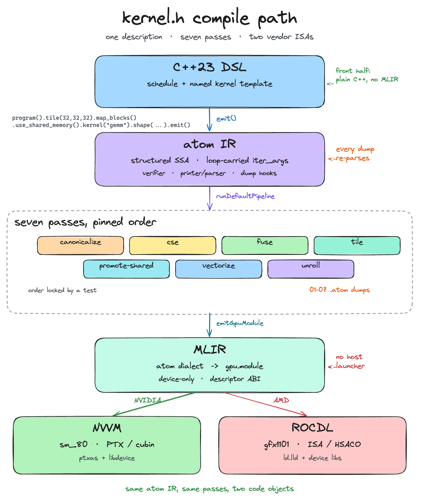
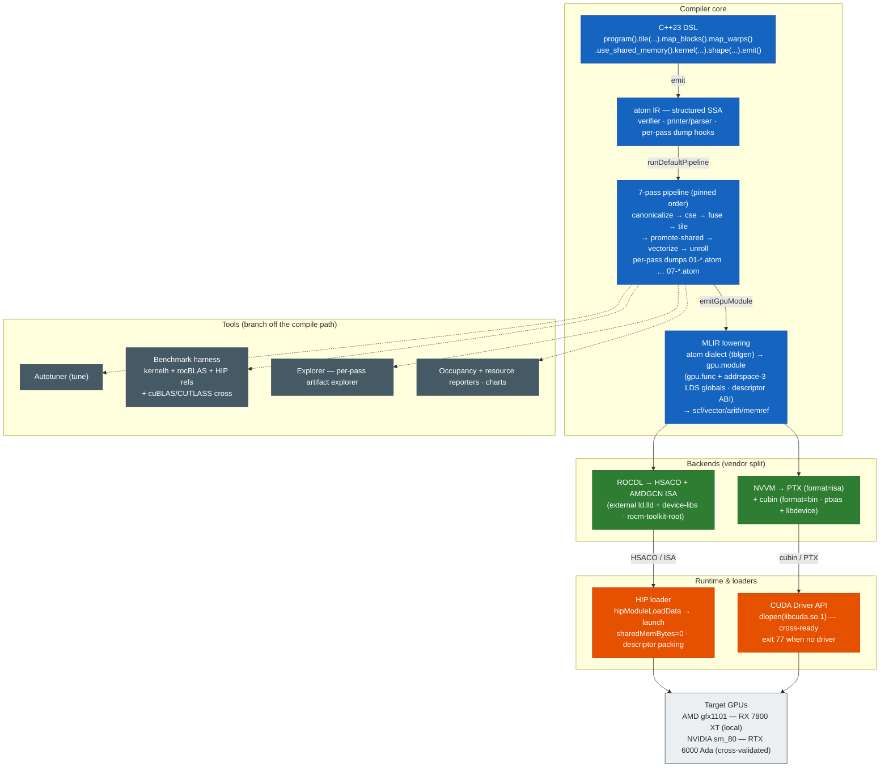
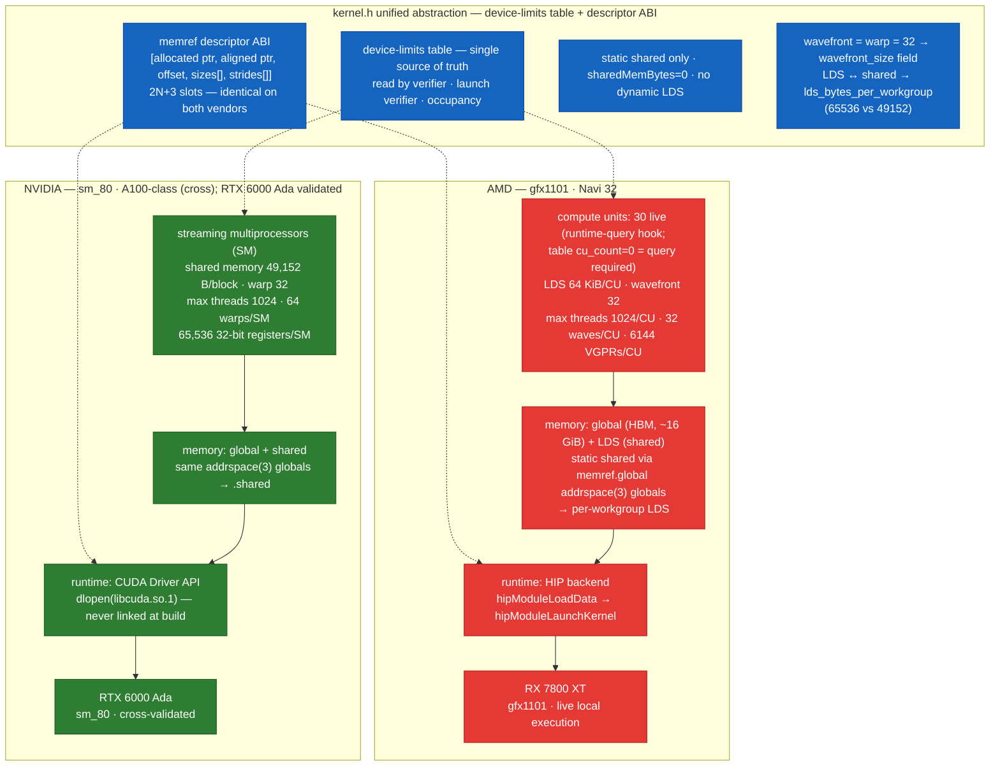

# kernel.h

**kernel.h is a cross-vendor GPU kernel compiler: C++23 DSL → structured SSA IR → MLIR → NVVM/ROCDL → PTX/cubin/HSACO.**

Measured and verified on: **AMD Radeon RX 7800 XT (gfx1101, Navi 32)** — kernels
run live on this GPU in full runtime mode (`degraded=false`). The NVIDIA path is
cross-compiled to `sm_80` and validated on real NVIDIA hardware (RTX 6000 Ada).

---

## Features

- **C++23 fluent DSL** — `kernelh::program().tile(128,128,32).map_blocks().map_warps().use_shared_memory().kernel("gemm").shape({{"m",512},{"n",512},{"k",512}}).emit()` binds a schedule to a named kernel template in a registry (no general expression language).
- **Structured SSA IR ("atom")** — pinned op inventory (loop-carried `iter_args`+`yield` for reductions, static shared-memory ops + barriers, launch intrinsics, vector memory ops), structural verifier, deterministic MLIR-like printer, full round-trip parser, per-pass dump hooks.
- **Seven-pass pipeline** in pinned canonical order: `canonicalize → cse → fuse → tile → promote-shared → vectorize → unroll`, with an order-lock test and re-parseable dumps.
- **Single source of truth device-limits table** — gfx1101 (`lds=65536 B`, wavefront 32, 6144 VGPRs/CU) and sm_80 (`lds=49152 B`, 64 warps/SM) with a runtime-query hook; used by the verifier, passes, launch verifier, and occupancy reports.
- **MLIR lowering** — custom tblgen "atom" dialect; device-only lowering to `gpu.module` (descriptor ABI, addrspace-3 static shared memory, no host machinery).
- **Two vendor backends** — NVVM → PTX text (`format=isa`) + cubin (`format=bin`, `ptxas` + libdevice via `l=`); ROCDL → HSACO + AMDGCN ISA (external `ld.lld` + device-libs via a `rocm-toolkit-root` linkFarm).
- **Thin runtime** — HIP module loader/launcher (`hipModuleLoadData`/`hipModuleGetFunction`/`hipModuleLaunchKernel`, plain `hipMalloc`, HIP-event timing) plus a CUDA Driver API backend bound via `dlopen("libcuda.so.1")` (cross-ready; skips with exit 77 when no driver).
- **Seven kernels** — vecadd, GEMM (tiled static-shared-memory), softmax (online), layernorm, prefix sum (two-pass Blelloch), fused_gelu (fusion proof), FlashAttention-lite — each verified on-GPU against an fp64 CPU reference with pinned tolerances.
- **Launch-config verifier** — pre-launch device-limit + occupancy checks.
- **Resource reporter** — per-kernel `resources.json` (vgpr/sgpr/lds/wavefront/occupancy) via `llvm-readobj`/`ptxas -v`.
- **Autotuner** — bounded config space, mandatory numeric re-verification, JSON cache keyed `kernel+shape+device`.
- **Benchmark harness** — kernelh + rocBLAS + hand-written HIP references (naive + vectorized) + cuBLAS/CUTLASS cross harness; warmup 5 + median-of-20 HIP-event timing; CSV schema.
- **Explorer CLI** — `kernelh explore` emits re-parseable per-pass IR dumps, MLIR stages, vendor artifacts, resources, occupancy, and an `index.md` (self-checked in-process).
- **Occupancy reports** — theoretical (device table + resources) + best-effort measured; cross-target analytic for `sm_80`.
- **Charts** — measured-ceiling roofline (Williams et al.), GEMM GFLOPS vs size, elementwise bandwidth, attention GFLOPS; machine-readable `charts_stats.csv`.
- **LaTeX technical report** — `docs/REPORT.md` (mirror) + `docs/report.pdf`.

## Quickstart

Everything runs inside the **devenv shell** (devenv.sh 2.x, LLVM/MLIR 21.1.8,
ROCm 7.2.3, CUDA 12.9 — prebuilt via the nix binary cache, no source builds).
The environment defines a `build` shell command.

```sh
# 1. Build (from the repo root)
devenv shell -- bash -c 'cd /home/mei/projects/kernel.h && build'

# 2. Run the full test suite (324 ctest tests: unit + lit + on-GPU e2e)
devenv shell -- bash -c 'cd /home/mei/projects/kernel.h && ctest --test-dir build --output-on-failure'

# 3. Quick sanity bench — measured roofline ceilings on this box
./build/tools/kernelh/kernelh bench --suite roofline --out build/bench

# 4. Explore one kernel end-to-end: 8 per-pass IR dumps, MLIR stages,
#    HSACO + ISA, resources, occupancy, index.md
./build/tools/kernelh/kernelh explore --kernel gemm --shape m=256,n=256,k=256 --target amdgcn-gfx1101 --out artifacts/run-demo

# 5. Compile one kernel to BOTH vendors (AMD artifacts run here;
#    NVIDIA cubin/PTX are ready to run on any sm_80 machine)
./build/tools/kernelh/kernelh compile --kernel vecadd --shape n=1024 --target amdgcn-gfx1101 --target nvptx-sm_80 --out build/demo

# 6. Full benchmark suite (roofline + kernelh + rocBLAS + HIP refs + cuda-cross)
./build/tools/kernelh/kernelh bench --suite all --out build/bench

# 7. Regenerate the charts + charts_stats.csv from the results
python3 scripts/charts.py build/bench/results.csv build/bench/charts

# 8. Build the LaTeX technical report (docs/report.pdf + aux files in docs/)
devenv shell -- bash -c 'cd /home/mei/projects/kernel.h && latexmk -pdf docs/report.tex'
```

Other entry points:

```sh
# Autotune GEMM (bounded, numeric re-verification, JSON cache)
./build/tools/kernelh/kernelh tune --kernel gemm --shape m=512,n=512,k=512 --max-candidates 8 --out artifacts/tune-report

# Occupancy-only report for a kernel+target
./build/tools/kernelh/kernelh bench --occupancy --kernel gemm --target amdgcn-gfx1101 --out build/bench/occ

# Debug/test driver: parse .atom, run passes, print IR (mlir-opt-style)
./build/tools/kernelh-opt/kernelh-opt --load-atom artifacts/run-demo/00-input.atom --run-passes=canonicalize,cse --print-atom
```

## Architecture



*kernel.h compile pipeline: C++23 DSL → atom IR → seven-pass optimizer → MLIR
lowering → NVVM/ROCDL vendor backends → thin HIP/CUDA runtime, with the kernelh
tools (autotuner, benchmark harness, explorer, occupancy/resource reporters)
branching off the compile path. [edit in Excalidraw](docs/diagrams/architecture.excalidraw.json)*

## Architecture diagrams

**App architecture — the compile + runtime flow:**



**NVIDIA/AMD card architecture — how kernel.h's unified abstraction maps onto each family:**



## Benchmark summary

All numbers are **real measurements** from `build/bench/results.csv` /
`build/bench/charts/charts_stats.csv` (generated by
`./build/tools/kernelh/kernelh bench --suite all --out build/bench` and
`python3 scripts/charts.py build/bench/results.csv build/bench/charts`;
warmup 5 + median of 20 HIP-event-timed launches; device "AMD Radeon RX 7800 XT").

**Measured roofline ceilings (this box):**

| microbenchmark | median ms | rate |
| --- | ---: | ---: |
| roofline_triad (3 GiB moved) | 9.34 | **344.9 GB/s** |
| roofline_fma (2^35 FMAs) | 4.43 | **15496.6 GFLOPS** |

Ridge point (arithmetic intensity where the ceilings meet): `AI = 15496.6 / 344.9 = 44.9 flops/byte` (`ceiling_ai = 44.931695`, `ceiling_gflops = 15496.611700` in `charts_stats.csv`; run-to-run spread of a few percent is expected — see REPORT §8.1).

**GEMM — kernelh vs rocBLAS:**

| shape (m=n=k) | kernelh GFLOPS | rocBLAS GFLOPS | ratio |
| --- | ---: | ---: | ---: |
| 512³ | 260.5 | 4633.0 | 17.8× |
| 1024³ | 473.1 | 7280.5 | 15.4× |
| 2048³ | 727.4 | 8928.3 | 12.3× |
| 4096³ | 1273.1 | 10216.0 | 8.0× |
| 8192³ | **1084.4** | **9779.2** | 9.0× |

**Elementwise / reduction kernels:**

| kernel | shape | kernelh | hipref-naive | hipref-vec |
| --- | --- | ---: | ---: | ---: |
| softmax | 4096×1024 | 8.6 GB/s | 467.7 | 720.4 |
| softmax | 16384×4096 | 9.6 GB/s | 423.0 | 499.1 |
| layernorm | 4096×1024 | 72.1 GB/s | 473.4 | 712.9 |
| layernorm | 16384×4096 | 68.8 GB/s | 410.4 | 492.0 |
| scan | 100000 | 3.16 GB/s | 3.57 | 3.66 |
| scan | 1000000 | 3.60 GB/s | 4.23 | 4.26 |
| fused_gelu | 2^20 | 620.4 GB/s | 639.4 | 685.3 |
| fused_gelu | 2^22 | 1085.7 GB/s | 1105.7 | 1056.9 |
| attention | b=2,h=8,seq=512 | **41.8 GFLOPS** | — | — |
| attention | b=2,h=8,seq=1024 | **43.8 GFLOPS** | — | — |

**Honest note, no parity claim:** kernel.h's GEMM is a scalar, tiled, static-
shared-memory kernel (f32 FMA, no tensor cores, no WMMA) — at 8192³ it is
~9.0× slower than rocBLAS, and the softmax/layernorm kernels run 7–84× below
the HIP references (they run scalar at `vector_width=1`). fused_gelu is
near-parity (fusion eliminates the intermediate tensor's round-trip), and scan
is within ~16% of the references. The kernelh-vs-vendor-lib gap is a documented
v1 limitation, not hidden — root causes and a prioritized fix list are in
[docs/REPORT.md](docs/REPORT.md) §§8–9.

## Artifact gallery

Generated locally by the quickstart commands above; `build/` and `artifacts/`
are gitignored, so these links resolve after you run them.

- **[GEMM, AMD gfx1101 explore](artifacts/run-report-amd/index.md)** — 8 per-pass IR dumps, MLIR stages, `gemm.isa` + `gemm.hsaco`, resources.json (vgpr 41 / lds 8192), occupancy, index.md.
- **[vecadd, NVIDIA sm_80 explore](artifacts/run-report-nv/index.md)** — the same artifact set for the NVVM path: `vecadd.ptx` + `vecadd.cubin`, ptxas resources (regs 20), 6.25% threads-limited occupancy.
- **[fused_gelu, AMD explore](artifacts/run-report-fused/index.md)** — fusion before/after dumps (the `03-fuse.atom` collapse).
- **[Autotune report](artifacts/tune-report/tune-results.csv)** — 8 evaluated GEMM configs, all rejected by mandatory numeric re-verification (an honest negative result — see REPORT §7).
- **[Charts](build/bench/charts/)** — [roofline.png](build/bench/charts/roofline.png), [gemm_gflops_vs_size.png](build/bench/charts/gemm_gflops_vs_size.png), [elementwise_bw.png](build/bench/charts/elementwise_bw.png), [attention_gflops.png](build/bench/charts/attention_gflops.png) + [charts_stats.csv](build/bench/charts/charts_stats.csv).
- **[Technical report](docs/report.pdf)** — LaTeX build of [docs/REPORT.md](docs/REPORT.md): IR design, pass pipeline, MLIR lowering, backends, runtime, autotuning, performance, limitations.

**CUDA-unfree note:** the devenv environment accepts unfree packages
(`nixpkgs.allow_unfree = true` in `devenv.yaml`) because the CUDA 12.9 toolchain
(`cuda_nvcc`, `cuda_cudart`, `libcublas`, CUTLASS headers) is required for the
NVIDIA cross path. The CUDA EULA was accepted at the environment gate. The
cuBLAS/CUTLASS benchmark harness additionally needs an NVIDIA GPU + driver to
run; on this box those rows skip with exit 77 (no CUDA driver — the NVIDIA path
is verified on rented RTX 6000 Ada hardware).
