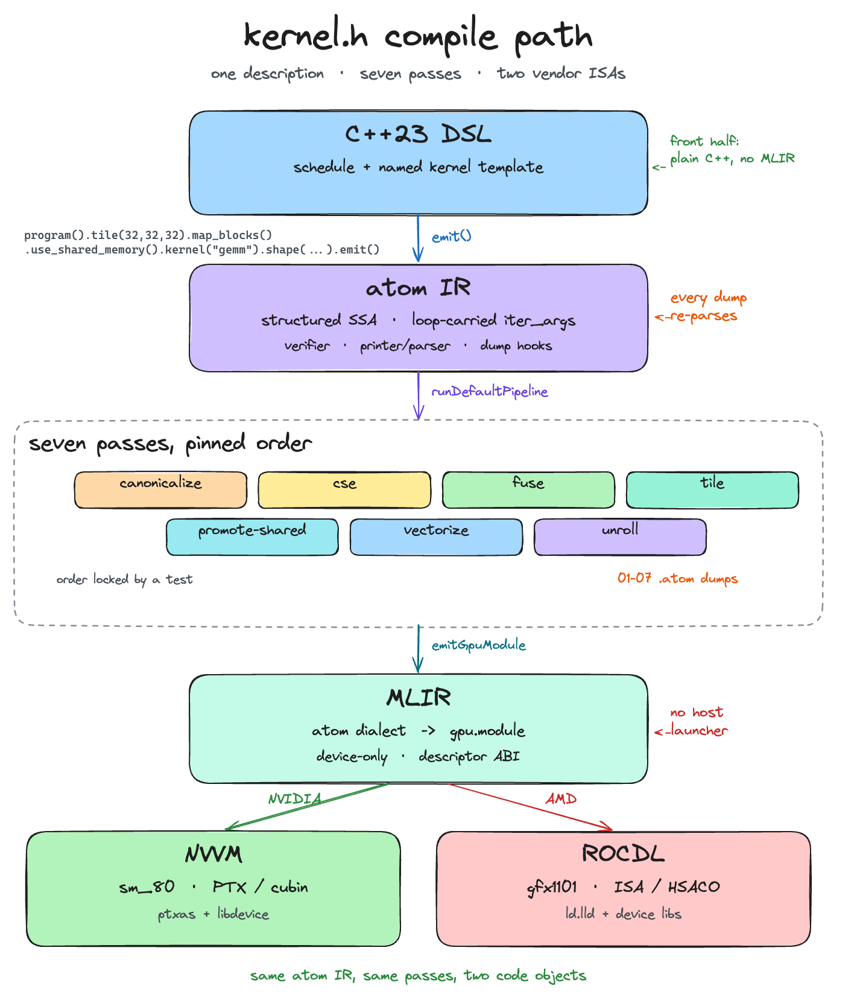
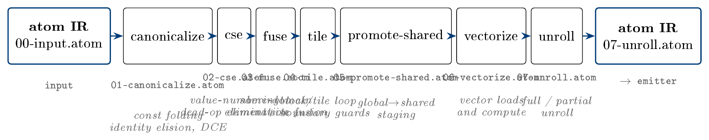
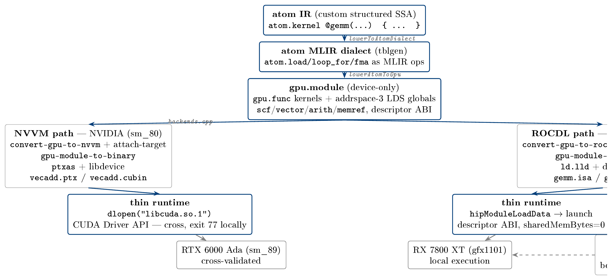

# I Wrote a GPU Kernel Compiler That Targets Both NVIDIA and AMD — From Scratch, on MLIR

*The one where a C++23 DSL becomes PTX and HSACO through my own little SSA IR, and a GPU hangs an entire desktop.*

I spent the last few weeks writing a GPU kernel compiler. Not a wrapper around another compiler, and not a CUDA wrapper that quietly shells out to `nvcc` — an actual compiler: a C++23 DSL that lowers a kernel description through a structured-SSA intermediate representation I designed, into [MLIR](https://arxiv.org/abs/2002.11054), and then out to real machine code for **both** major GPU vendors. AMD's ROCDL path emits HSACO and runs live on the Radeon RX 7800 XT in my machine. NVIDIA's NVVM path emits PTX and cubin, cross-compiled from a machine with no NVIDIA GPU, and runs — and numerically verifies — on a rented RTX 6000 Ada pod.

It's called **kernel.h**, and this post is the story: why I built it, how it's wired together, what it actually measures, and the bugs that nearly killed it.

---

## Why build a kernel compiler?

Honest answer: because writing GPU kernels by hand is miserable, and autotuning over handwritten variants is worse.

The standard workflow for a GEMM on AMD looks like: pick a tiling, write the kernel in HIP, benchmark it against rocBLAS, feel bad, change the tile size, benchmark again, feel worse. Every schedule choice — block dimensions, tile shape, whether to stage through shared memory, vector width, unroll factor — is baked into the source. The moment you want to try a different one, you're editing code, not tuning a knob. The community answer is giant C++ template metaprogramming libraries like CUTLASS that turn schedules into template parameters, but those are enormous, vendor-specific, and fighting them is its own full-time job.

I wanted the kernel *description* to be separate from the *schedule*. I wanted `program().tile(128,128,32).map_blocks().map_warps().use_shared_memory().kernel("gemm").shape({{"m",512},{"n",512},{"k",512}}).emit()` to be a real, compilable thing — and I wanted the autotuner to be able to vary that schedule and get a *correct* kernel out the other side.

And then the second honest answer: the [MLIR](https://arxiv.org/abs/2002.11054) ecosystem makes this genuinely tractable now. The upstream compiler infra has `gpu`/`nvvm`/`rocdl` dialects, vendor serializers that turn a `gpu.module` into PTX/cubin/HSACO without touching a GPU, and a clean path for out-of-tree custom dialects. The hard, interesting, *doable-by-one-person* part is the front half: the DSL, the IR, the passes, the numerics. MLIR does the last mile.

---

## The architecture

One kernel description, both vendors, one pipeline:



*The full compile pipeline — DSL → atom IR → seven-pass optimizer → MLIR → NVVM/ROCDL → thin HIP/CUDA runtime. [Edit the diagram in Excalidraw](../diagrams/architecture.excalidraw.json).*

The compiler has three distinct halves. A **C++23 DSL** (`program().tile(...).kernel("gemm")...`) binds a schedule to a named kernel template — there's no general expression language, just a builder for my IR. A **custom structured-SSA IR** called *atom* (`lib/ir`) is the middle: a pinned op inventory, a structural verifier, a deterministic printer, and a full round-trip parser. And the **MLIR back half** (`lib/compiler`) lowers atom to a custom tblgen dialect, then to `gpu`/`scf`/`vector`, then through the vendor serializers.

The runtime is deliberately thin: a HIP module loader (`hipModuleLoadData` → launch, descriptor-ABI arguments, static shared memory only) for the local AMD path, and a CUDA Driver API backend loaded via `dlopen("libcuda.so.1")` for the cross path. On top of that sit the tools: an autotuner, a benchmark harness that races my kernels against rocBLAS, a resource reporter that reads VGPR/LDS counts out of the generated code objects, and an explorer that dumps every intermediate stage.

---

## The IR and the seven-pass pipeline

The atom IR is **structured SSA**: nested block scopes, no gotos, no phis. The only control flow is `atom.loop_for ... iter_args() -> (...)`, a structured loop that is simultaneously the only SSA merge point — loop-carried values like GEMM's accumulator or softmax's running max/sum are just the loop's `iter_args`, terminated by `atom.yield`. That sounds like a restriction, and it is, deliberately. It makes three things nearly free:

- **Reductions are first-class.** Every "stateful" kernel — softmax's online statistics, scan's carry, attention's rescaling — is expressible as loop-carried iter_args without any CFG round-trip.
- **The verifier is cheap and loud.** Dominance, barrier placement, shared-memory budgets are all structural properties. `verifyModule` reports *every* violation in one pass, never early-exits.
- **Every intermediate is re-parseable text.** The printer and parser are exact inverses, so the explorer can dump the IR after every pass and re-verify each dump from disk. If a pass ever corrupts the IR, the compiler refuses to proceed — fail loud, not fail silently.

The seven passes run in a pinned order — `canonicalize → cse → fuse → tile → promote-shared → vectorize → unroll` — with an order-lock test that proves the order is load-bearing (swap two passes and the tests fail):



*The pipeline, in canonical order (`kernelh::passes::defaultPipelineOrder()`). Each pass re-emits a deterministic, re-parseable dump named `NN-<pass>.atom`.*

A couple of details I'm fond of: `canonicalize` elides `x + 0.0` — which is exactly what lets `vectorize` widen the fused chain downstream (there's no vector splat in the IR, so a stray constant blocks widening). `fuse` collapses same-domain elementwise producer/consumer loops into one nest, eliminating the intermediate buffer's global round-trip — the fused_gelu kernel exists to prove it. And `tile` rewrites the domain loop into block/tile form with boundary guards, computing `gi = block_id*BM + i*W + wf` and wrapping exactly the memory ops whose index chains reach the induction.

---

## MLIR and the two backends

The lowering is deliberately **device-only**. The emitter produces a `gpu.module` with `gpu.func` kernels, addrspace-3 static shared-memory globals, `scf`/`vector`/`arith`/`memref` bodies, and **no** `gpu.launch`, no host-side generated launcher, no MLIR ExecutionEngine. The runtime talks to the kernel at the device-ABI level directly — descriptor-packed memref arguments, `sharedMemBytes=0`. The compiler and the runtime never link the same libraries; the runtime doesn't touch MLIR at all.



*From atom IR to vendor artifacts: two stages of MLIR lowering into a gpu.module, then the NVVM and ROCDL serializers in parallel, then the thin runtime that loads either one.*

The vendor serialization is the part that still feels like magic even though I understand it now: `gpu-module-to-binary` never touches a GPU. The ROCDL path hands a module to ROCm's external `ld.lld` plus the `amdgcn/bitcode` device-libs and gets an HSACO back; the NVVM path runs `ptxas` against libdevice and gets a cubin. My compiler just has to make sure the toolkit paths are right, the kernel markers are `gpu.kernel` and not a literal `kernel`, and the module it hands over is a `gpu.module` those serializers actually accept. Each artifact is compiled from a fresh clone because the serializer mutates the module in place.

---

## What actually runs

Every number below is a real measurement from a fresh `kernelh bench --suite all` run on the RX 7800 XT (warmup 5, median of 20 HIP-event-timed launches). The honest headline first: **this is a from-scratch educational compiler, not a cuBLAS killer.**

Measured ceilings on this box (from `build/bench/results.csv`, this session):

| microbenchmark | median ms | rate |
| --- | ---: | ---: |
| roofline_triad (3 GiB streamed) | 9.26 | **347.7 GB/s** |
| roofline_fma (2^35 FMAs) | 4.45 | **15455.7 GFLOPS** |

The [roofline](https://doi.org/10.1145/1498765.1498785) ridge — where the DRAM and compute ceilings meet — is at an arithmetic intensity of 15455.7 / 347.7 ≈ **44.5 flops/byte**.

**GEMM, kernelh vs. rocBLAS (same box, same fp32):**

| shape | kernelh GFLOPS | rocBLAS GFLOPS | ratio |
| --- | ---: | ---: | ---: |
| 512³ | 271.0 | 4641.0 | 17.1× |
| 1024³ | 495.5 | 7485.6 | 15.1× |
| 2048³ | 711.1 | 8689.2 | 12.2× |
| 4096³ | 1293.8 | 9719.7 | 7.5× |
| 8192³ | **1075.1** | **9838.3** | **9.2×** |

At 8192³ my GEMM sustains ~1.07 TFLOPS against rocBLAS's ~9.8 — about a **9× gap**, largest at small sizes. And here's the why, honestly: my GEMM is a *scalar, tiled, static-shared-memory* kernel. f32 FMA, no WMMA, no tensor cores, no register blocking, 12.5% occupancy (41 VGPRs/thread), one k-tile staged at a time with no double buffering. rocBLAS gets to ~65% of the machine's measured FMA ceiling; I get to about 7%.

The rest of the suite:

| kernel | shape | kernelh | hipref-naive | hipref-vec |
| --- | --- | ---: | ---: | ---: |
| softmax | 4096×1024 | **8.4 GB/s** | 462.2 | 702.0 |
| softmax | 16384×4096 | **9.6 GB/s** | 419.5 | 502.7 |
| layernorm | 4096×1024 | **68.8 GB/s** | 471.2 | 705.4 |
| scan | 100000 | 3.19 GB/s | 3.55 | 3.68 |
| fused_gelu | 2^22 | **1077.3 GB/s** | 1106.2 | 1059.6 |
| attention | b=2,h=8,seq=1024 | **43.5 GFLOPS** | — | — |

The softmax/layernorm gap (8–70 vs 400–700 GB/s) is my honest weak spot: those are bandwidth-bound kernels and my default schedules run them *scalar* (`vector_width=1`) where the HIP references use float4. Meanwhile `fused_gelu` is at parity — the fusion pass eliminated the intermediate tensor's round-trip through global memory — and `scan` sits within ~15% of the references. Attention reaches ~43 GFLOPS in its online, tiled, fp32 form (the same online-softmax trick [FlashAttention](https://arxiv.org/abs/2205.14135) made famous, at a much smaller scale).

---

## War stories

The blog's favorite part. All real, all from the notepads.

**The GPU hang that killed my desktop.** The original GEMM was a serial `O(m·n·k)` skeleton, and its loads were nested so deep that the `promote-shared` pass couldn't stage them. Result: `group_segment_fixed_size: 0` in the HSACO — *zero* shared memory, *zero* `ds_` instructions — and every one of the 256 threads redundantly computing the entire product at ~12 GFLOPS. An 8192³ launch took ~44 seconds, and the benchmark launched it 25 times. The AMD watchdog (lockup_timeout) fired, the GPU reset, and my entire desktop session died. The fix was to stop relying on the pass and **pre-stage tiles into static LDS in the template itself** — tid-partitioned staging loops, two barriers per k-tile, exactly like scan and attention already did. The fixed kernel runs 8192³ in ~1.0 s with `group_segment_fixed_size: 8192` and 18 `ds_` instructions in the ISA. While I was in there I also found a `map_warps` bug that made all 128 output columns equal to one value (rel-Frobenius 0.035), and a column-major LDS layout that put all 32 lanes on the same memory bank — 32-way conflicts, 410 ms → 137 ms at 4096³ just from going row-major.

**The CUDA dlopen bug hunt (found via a rented GPU).** My CUDA backend loads the driver with `dlopen("libcuda.so.1")` and resolves 24 symbols. It had never run on real NVIDIA hardware — on this machine `dlopen` just fails and everything skips with exit 77. On the RTX 6000 Ada pod it failed instantly: `dlsym(CuInit) failed`. The driver exports `cuInit` — lowercase — and my table asked for `CuInit`. That was one bug. Then: `cuMemAlloc` (deprecated alias) returns `CUDA_ERROR_INVALID_CONTEXT` even with the context current; the `_v2` variants are what modern drivers actually export. That was the second. And the third: my local enum had warp size = attribute 39 and multiprocessor count = 41, when the real values are 10 and 16 — attribute 39 returned 1536 (max threads per SM) where I expected 32, and 41 returned 1 where the RTX 6000 Ada has 142 SMs. Three bugs, all invisible locally, all caught on the first real-hardware run. The lesson is uncomfortable: **a path you can't execute is a path you haven't tested.**

**The autotuner caught a real compiler bug.** Every `unroll=2` GEMM config fails numeric re-verification — rel-Frobenius 0.88–0.97 instead of < 1e-5. Root cause: the unroll pass's partial-unroll cleanup loop mis-remaps the k-loop's iter_args carry chain, corrupting the accumulator. The autotuner's mandatory re-verification gate — no candidate accepted without a numeric check against the fp64 reference — correctly discarded all 8 sampled configs. That's a designed feature doing exactly its job: the search ended with "no accepted candidate" rather than shipping a subtly wrong kernel. The bug is still open, and it's the top of my fix list.

**The scan kernel needed double-float to be bit-exact.** The pinned tolerances for scan are *smaller than one fp32 ulp* of the large prefix sums — ulp(5×10⁵) ≈ 0.03 against tolerances of 1e-4. A plain fp32 Blelloch scan is off by up to ~10 ulps at 2²⁰ elements. The kernel uses [Knuth TwoSum](https://en.wikipedia.org/wiki/Kahan_summation_algorithm) hi/lo double-float arithmetic in LDS for pass 1, a Shewchuk three-word expansion for the per-block offsets in pass 2, and a TwoSum-based final rounding — and it comes out bit-exact against the round-to-fp32 fp64 reference at every pinned size. Double-precision emulation in fp32, in a kernel compiler. That one still makes me smile.

---

## Cross-vendor validation: the cheapest GPU I could rent

Everything NVIDIA-side is cross-compiled from a machine with no NVIDIA hardware. To actually *prove* the path works, I rented an **RTX 6000 Ada pod** from PrimeIntellect — 48 GB, at $0.75/hour, the cheapest real NVIDIA execution I could find. The pod has a driver but no nvcc, which is fine: the whole point is that my compiler produces the cubin. I compiled `vecadd` to `nvptx-sm_80` locally, `scp`'d the 3.5 KB cubin over, built a CUDA-only subset of the runtime with the pod's g++-12, and ran it:

```
NV-BACKEND-OK, NV-DEVICE (cu=142 lds=49152 wavefront=32 maxThreads=1024),
NV-MODULE-LOAD-OK, NV-LAUNCH-OK (grid=4096 block=256),
NV-VECADD-PASS (N=1048576, out[i]=in0[i]+in1[i] verified host-side)
```

The full production chain — DSL → pipeline → emitter → NVVM → cubin → descriptor-ABI launch → numeric verification — runs on real NVIDIA hardware. That's the cross-vendor story in one log line, and it's the reason the dlopen bug hunt above is a *story* rather than a permanent mystery.

---

## Limitations (an honest accounting)

1. **No WMMA / MFMA / tensor cores.** Deliberate: gfx1101 WMMA is untrusted upstream in the ROCm stack I'm on, and I require zero `wmma`/`mfma` hits in the codebase. GEMM and attention run on scalar f32 FMAs, which is the single biggest reason for the 9× GEMM gap.
2. **Static shared memory only in v1.** `sharedMemBytes=0` at launch; the LDS budget is baked at compile time. Attention already sits at 33 KB of its 64 KB budget.
3. **NVIDIA is cross-only on this box.** No NVIDIA hardware locally; the local `bench` suite's cuBLAS/CUTLASS rows exit 77.
4. **The unroll bug.** The iter_args remap corruption above is a real, open correctness bug; the autotuner currently rejects the entire unroll=2 corner of its config space.
5. **Softmax/layernorm run scalar.** `vector_width=1` in the default schedules; the vectorize pass exists but these kernels don't use it yet.

## What I'd do next

First: **fix the unroll pass** — it's a correctness bug and it unlocks a whole dimension of the autotune space. Then: **double-buffer the GEMM k-tile** (the biggest single performance lever left — the memory pipeline is idle during compute today), and add **register-blocked accumulation** to cut the 41-VGPR footprint and lift occupancy off 12.5%. Then enable float4 vectorization on the bandwidth-bound kernels. And at some point, when ROCm's WMMA story matures, tensor cores — carefully, with the correctness history in mind.

The gap to rocBLAS is real, and I'm not going to pretend otherwise. But the compiler that loses that race by 9× also generates correct HSACO on my desk and correct cubin on a rented pod a thousand miles away — from the same C++23 description, through an IR I designed and passes I wrote. That's the part that feels like it was worth it.

*Numbers: fresh `kernelh bench --suite all` run, `build/bench/results.csv`. This post is the companion to the full technical report at `docs/report.pdf` / `docs/REPORT.md`, which documents every pass, every pipeline decision, and every measurement in the gory detail a compiler deserves.*
